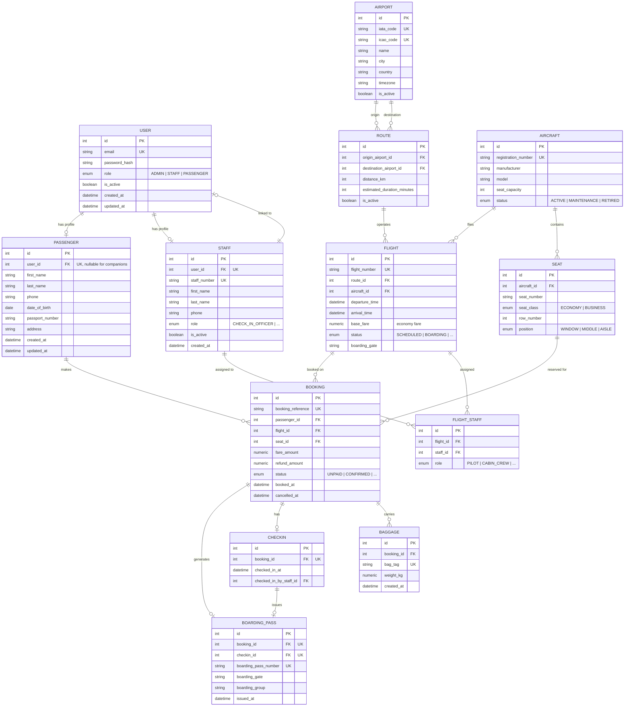

# 🗄️ Database Design

> **Airline Management System**
> PostgreSQL 14+ · SQLAlchemy 2.x · 17 tables · 6 enums · full referential integrity.

---

## Table of Contents

1. [Overview](#1-overview)
2. [Entity-Relationship Diagram (ERD)](#2-entity-relationship-diagram-erd)
3. [Table Reference](#3-table-reference)
4. [Booking Status State Machine](#4-booking-status-state-machine)
5. [Indexes](#5-indexes)
6. [Data Seeding](#6-data-seeding)
7. [Migration Scripts](#7-migration-scripts)

---

## 1. Overview

The system uses **PostgreSQL 14+** with **SQLAlchemy 2.x** as the ORM.

Every entity follows a consistent pattern:

- `id` — integer primary key (auto-increment)
- `created_at` / `updated_at` — UTC timestamps
- Foreign-key relationships with explicit `ondelete` behavior where needed

---

## 2. Entity-Relationship Diagram (ERD)

**Diagram — Entity-Relationship Diagram**



---

## 3. Table Reference

### 3.1 `users`

Primary authentication table for all roles.

| Column | Type | Constraints | Notes |
|---|---|---|---|
| `id` | INTEGER | PK | Auto-increment |
| `email` | VARCHAR(255) | UNIQUE, NOT NULL, INDEXED | Lowercased on insert |
| `password_hash` | VARCHAR(255) | NOT NULL | bcrypt hash |
| `role` | ENUM | NOT NULL | `ADMIN` · `STAFF` · `PASSENGER` |
| `is_active` | BOOLEAN | NOT NULL, DEFAULT TRUE | Soft-disable accounts |
| `created_at` | DATETIME | NOT NULL | UTC |
| `updated_at` | DATETIME | NOT NULL, ON UPDATE | UTC |

**Relationships**

- 1:1 with `passengers` (nullable)
- 1:1 with `staff` (nullable)

---

### 3.2 `passengers`

Profile for passenger users (also used for companions without accounts).

| Column | Type | Constraints | Notes |
|---|---|---|---|
| `id` | INTEGER | PK | |
| `user_id` | INTEGER | FK → `users.id`, UNIQUE, NULLABLE | `NULL` for companions |
| `first_name` | VARCHAR(100) | NOT NULL | |
| `last_name` | VARCHAR(100) | NOT NULL | |
| `phone` | VARCHAR(30) | NOT NULL | |
| `date_of_birth` | DATE | NULLABLE | |
| `passport_number` | VARCHAR(50) | NOT NULL | |
| `address` | VARCHAR(500) | NULLABLE | |

**Relationships**

- 1:N with `bookings`

---

### 3.3 `aircraft`

Fleet inventory; each aircraft contains a fixed number of seats.

| Column | Type | Constraints |
|---|---|---|
| `id` | INTEGER | PK |
| `registration_number` | VARCHAR(50) | UNIQUE, NOT NULL |
| `manufacturer` | VARCHAR(100) | NOT NULL |
| `model` | VARCHAR(100) | NOT NULL |
| `seat_capacity` | INTEGER | NOT NULL, > 0 |
| `status` | ENUM | `ACTIVE` · `MAINTENANCE` · `RETIRED` |

---

### 3.4 `seats`

Individual seat inventory per aircraft.

| Column | Type | Constraints |
|---|---|---|
| `id` | INTEGER | PK |
| `aircraft_id` | INTEGER | FK → `aircraft.id`, NOT NULL |
| `seat_number` | VARCHAR(10) | NOT NULL |
| `seat_class` | VARCHAR(8) | `ECONOMY` · `BUSINESS` |
| `row_number` | INTEGER | NOT NULL |
| `position` | VARCHAR(6) | `WINDOW` · `MIDDLE` · `AISLE` |

> **Note:** Seats are auto-generated via `SeatGenerator.generate(capacity)` when an aircraft is created.

---

### 3.5 `flights`

Scheduled operations of a route by an aircraft.

| Column | Type | Constraints |
|---|---|---|
| `id` | INTEGER | PK |
| `flight_number` | VARCHAR(20) | UNIQUE, NOT NULL, INDEXED |
| `route_id` | INTEGER | FK → `routes.id` |
| `aircraft_id` | INTEGER | FK → `aircraft.id` |
| `departure_time` | DATETIME | NOT NULL, INDEXED |
| `arrival_time` | DATETIME | NOT NULL |
| `base_fare` | NUMERIC(10,2) | NOT NULL — **economy fare** |
| `status` | ENUM | `SCHEDULED` · `BOARDING` · `DEPARTED` · `ARRIVED` · `DELAYED` · `CANCELLED` |
| `boarding_gate` | VARCHAR(20) | NULLABLE |

**Check constraint:** `departure_time < arrival_time`

---

### 3.6 `bookings`

The core transactional table.

| Column | Type | Constraints |
|---|---|---|
| `id` | INTEGER | PK |
| `booking_reference` | VARCHAR(20) | UNIQUE, NOT NULL |
| `passenger_id` | INTEGER | FK → `passengers.id` |
| `flight_id` | INTEGER | FK → `flights.id` |
| `seat_id` | INTEGER | FK → `seats.id` |
| `fare_amount` | NUMERIC(10,2) | NOT NULL |
| `refund_amount` | NUMERIC(10,2) | NULLABLE |
| `status` | ENUM | `UNPAID` · `CONFIRMED` · `CHECKED_IN` · `COMPLETED` · `CANCELLED` · `REFUND_REQUESTED` · `REFUNDED` |
| `booked_at` | DATETIME | NOT NULL |
| `cancelled_at` | DATETIME | NULLABLE |

**Unique constraint:** `(flight_id, seat_id)` — prevents double-booking a seat on the same flight.

---

## 4. Booking Status State Machine

**Diagram 7 — Booking Status State Machine**


---

## 5. Indexes

| Table | Index | Purpose |
|---|---|---|
| `users` | `email` | Login lookup |
| `passengers` | `user_id` | Join from user |
| `passengers` | `passport_number` | Passport uniqueness check |
| `aircraft` | `registration_number` | Fast aircraft lookup |
| `seats` | `aircraft_id` | Fetch seat map |
| `flights` | `flight_number` | Search |
| `flights` | `departure_time` | Date-range queries |
| `bookings` | `booking_reference` | Reference lookup |
| `bookings` | `(flight_id, seat_id)` UNIQUE | Prevent double-booking |

---

## 6. Data Seeding

The database is seeded by `app/config/seed_database.py` with:

- **Airports:** Dhaka (DAC), Cox's Bazar (CXB), Bangkok (BKK), Guangzhou (CAN), Chittagong (CGP), Jashore (JSR)
- **Aircraft:** 4 real aircraft + test variants
- **Routes:** DAC ↔ CXB, DAC ↔ BKK, CGP ↔ DAC, and others
- **Users:** 1 admin, 1 staff, 1 passenger
- **Flights:** Several scheduled flights per route

---

## 7. Migration Scripts

When the schema changes, run the appropriate migration:

```bash
python migrate_multi_passenger.py   # Example migration
python backfill_seats.py            # Fix any missing seats
```

**Always back up the database first:**

```bash
pg_dump -U postgres airline_management > backup.sql
```